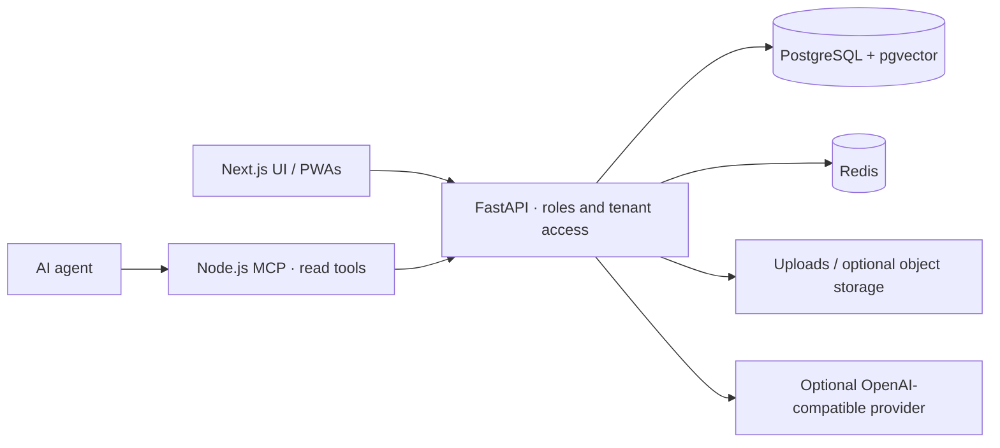

<p align="center">
  
</p>

<h1 align="center">Palmscout</h1>

<p align="center"><strong>Recruiting and staffing on your own infrastructure.</strong></p>

<p align="center">
  <a href="LICENSE"></a>
  
  
  
  
  <a href="CONTRIBUTING.md"></a>
</p>

<p align="center">
  <a href="https://neurofunken.de"></a><br>
  <sub>a neurofunken project</sub>
</p>

---

Palmscout is a self-hostable recruiting, staffing and temporary-work platform from neurofunken. It brings jobs, applications, company workspaces and workforce administration together on infrastructure you control.

> **Status:** early open-source release. Deployment and integrations require operator review; AI suggestions do not make hiring decisions.

## Contents

[Features](#features) · [Architecture](#architecture) · [Quick start](#quick-start) ·
[Configuration](#configuration) · [AI providers](#ai-providers-vendor-neutral) ·
[MCP server](#mcp-server) · [Agent skill](#agent-skill) · [Documentation](#documentation)

## Features

- Jobs, candidate profiles, applications and recruiter pipelines.
- Company workspaces and recruiting collaboration.
- Staffing, scheduling and temporary-work administration.
- Worker interface, documents and optional finance/invoice-validation services.
- Optional LLM assistance and external account integrations.
- Read-only MCP server and agent skill for assisted operations.

## Architecture



More: [architecture](docs/ARCHITECTURE.md).

## Quick start

```sh
# Requirements: Docker with Compose, Node.js 24
cp .env.example .env
# Replace password/signing-key placeholders; keep database and Redis URLs in sync.
docker compose -f docker-compose.yml up --build -d backend
cd frontend
npm ci
NEXT_PUBLIC_API_URL=http://localhost:8001 NEXT_PUBLIC_APP_URL=http://localhost:3001 npm run dev -- --port 3001
# Stop the frontend with Ctrl-C. From the repository root:
# docker compose -f docker-compose.yml down
```

UI: `http://localhost:3001` · API: `http://localhost:8001/docs`.
The backend startup applies Alembic migrations. PostgreSQL and Redis stay on the Compose network.
This quick start runs the frontend locally: the production frontend Dockerfile requires an explicit
pinned Node image and HTTPS origins, so the inherited all-services Compose build is not the local entrypoint.
For local development accounts, run
`docker compose -f docker-compose.yml exec backend python scripts/seed_test_users.py`.

Compose passwords such as `hireos_secret` and `redis_secret` are development-only; change them for any real deployment. QuickWork and associated seed/test names are fictional demo data. The product logo is a placeholder, not the final mark.

## Configuration

| Variable | Purpose |
| --- | --- |
| `DATABASE_URL` | PostgreSQL asyncpg URL; use an isolated test database for tests |
| `REDIS_URL` | Redis URL including configured password |
| `SECRET_KEY` | Random signing key; replace the example before starting |
| `APP_ENV`, `ALLOWED_ORIGINS`, `FRONTEND_URL` | Environment and permitted browser origins |
| `LEGAL_*` | Operator details and review status; blank fields keep legal pages in draft |
| `OPENAI_API_KEY`, `OPENAI_BASE_URL`, `OPENAI_MODEL` | Optional OpenAI-compatible provider |
| `AI_MOCK_MODE`, `AI_MAX_TOKENS`, `AI_REQUESTS_PER_MIN` | Offline fallback, token budget and process-local throttle |
| `PALMSCOUT_BASE_URL`, `PALMSCOUT_TOKEN`, `PALMSCOUT_READ_ONLY` | MCP client environment; read-only defaults to true |

See [.env.example](.env.example) and [configuration](docs/CONFIGURATION.md). `HIREOS_*` port variables and `hireos_*` compose/database names are legacy technical identifiers.

## AI providers (vendor-neutral)

Optional AI uses OpenAI-compatible Chat Completions; set a base URL, model and provider key where required. Local endpoints can run without a real key. `AI_MOCK_MODE=true` skips remote client construction.

| Provider | `OPENAI_BASE_URL` | Example `OPENAI_MODEL` | Key |
| --- | --- | --- | --- |
| OpenAI | `https://api.openai.com/v1` (or unset) | `gpt-4o-mini` | Required |
| Mistral | `https://api.mistral.ai/v1` | `mistral-small-latest` | Required |
| OpenRouter | `https://openrouter.ai/api/v1` | `openai/gpt-4o-mini` | Required |
| Ollama | `http://127.0.0.1:11434/v1` | `llama3.2` | Optional locally |
| LM Studio | `http://127.0.0.1:1234/v1` | Your loaded model ID | Depends on server auth |
| vLLM | `http://127.0.0.1:8000/v1` | Your served model ID | Depends on server auth |

Examples and data handling: [AI providers](docs/AI-PROVIDERS.md).

## MCP server

Package `@palmscout/mcp`, executable `palmscout-mcp`; dependency-free Node.js 20+ stdio.
Run from the checkout; no registry publication is assumed. [Tools and safety](mcp/README.md).
All exposed tools are read-only. `PALMSCOUT_READ_ONLY=true` is the default.

### Claude Desktop, Cursor and generic MCP JSON

Place this entry in your client's MCP configuration (for Cursor, `.cursor/mcp.json`).
Replace the absolute path and token locally, never in committed files.

```json
{
  "mcpServers": {
    "palmscout": {
      "command": "node",
      "args": [
        "/absolute/path/to/palmscout-oss/mcp/src/server.mjs"
      ],
      "env": {
        "PALMSCOUT_BASE_URL": "http://127.0.0.1:8001",
        "PALMSCOUT_TOKEN": "<access-token>",
        "PALMSCOUT_READ_ONLY": "true"
      }
    }
  }
}
```

### Claude Code

```sh
claude mcp add Palmscout --env PALMSCOUT_BASE_URL=http://127.0.0.1:8001 --env PALMSCOUT_TOKEN='<access-token>' --env PALMSCOUT_READ_ONLY=true -- node /absolute/path/to/palmscout-oss/mcp/src/server.mjs
```

### Codex

Add to your local MCP configuration:

```toml
[mcp_servers.palmscout]
command = "node"
args = ["/absolute/path/to/palmscout-oss/mcp/src/server.mjs"]
env = { PALMSCOUT_BASE_URL = "http://127.0.0.1:8001", PALMSCOUT_TOKEN = "<access-token>", PALMSCOUT_READ_ONLY = "true" }
```

## Agent skill

[skills/palmscout/SKILL.md](skills/palmscout/SKILL.md) teaches identity/scope checks, minimal reads and
human approval for any future destructive or publish operation. Copy the folder into your
agent's skill directory. [Setup and local-model use](docs/MCP-AND-SKILLS.md).

## Documentation

| Document | Topic |
| --- | --- |
| [Architecture](docs/ARCHITECTURE.md) | Components and boundaries |
| [Configuration](docs/CONFIGURATION.md) | Environment, deployment and tests |
| [AI providers](docs/AI-PROVIDERS.md) | Hosted and local model setup |
| [MCP and skills](docs/MCP-AND-SKILLS.md) | Client examples and operating workflow |
| [German documentation](docs/README.de.md) | Product and local operation |
| [Integrations](docs/INTEGRATIONS.md) · [E-invoicing](docs/E_RECHNUNG_UND_STEUERSCHNITTSTELLEN.md) | Optional services (German) |

## Contributing

Please read [CONTRIBUTING.md](CONTRIBUTING.md) and the [Code of Conduct](CODE_OF_CONDUCT.md).
Report vulnerabilities privately through [SECURITY.md](SECURITY.md).

## License

[MIT](LICENSE) © 2026 Hanns Leonhard Osterbrink / neurofunken.

## Kurzfassung (Deutsch)

Palmscout ist die selbst hostbare Plattform für Recruiting, Personalplanung und Zeitarbeit von neurofunken. Das Produkt befindet sich in einer frühen Pilotphase. KI ist optional und anbieterneutral. MCP und Agent Skill unterstützen lesende Arbeitsabläufe.
Ausführlicher: [deutsche Dokumentation](docs/README.de.md).
