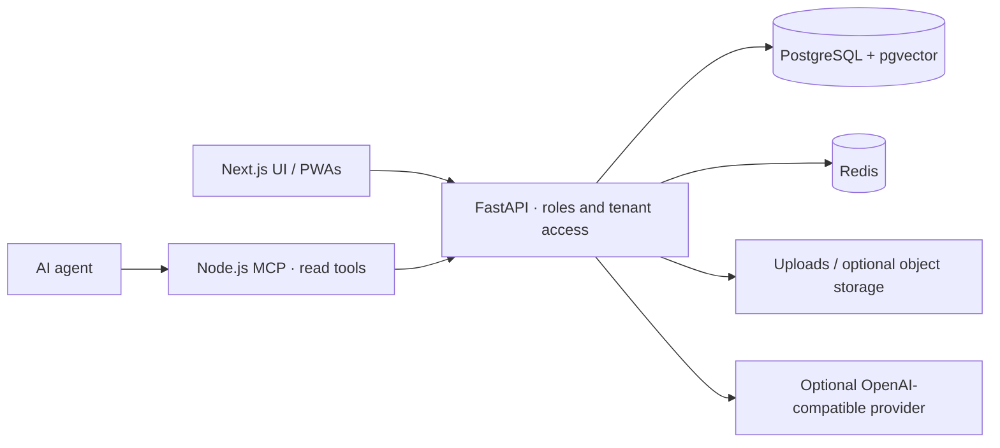

# Palmscout architecture

`frontend/` is the Next.js/React TypeScript application. `backend/app/main.py` assembles
FastAPI routers. PostgreSQL stores domain records and pgvector embeddings; Redis supports
background/realtime infrastructure. Alembic owns schema migrations. Uploads and optional
object storage must be backed up alongside the database. Optional invoice validation runs
in its own service; see `services/invoice-validator/`.

Palmscout combines recruiting jobs and applications, candidate profiles, company workspaces, worker scheduling and temporary-work administration. Routers under `/jobs`, `/applications`, `/companies`, `/worker` and `/zeitarbeit` apply backend role/tenant checks. Optional integrations and finance capabilities require their own configuration.

The MCP process is a separate authenticated HTTP client, not a database client. It exposes a
small read-only route inventory and forwards the operator's bearer token. It never grants
permissions beyond the current account. The shared AI client uses optional base URL, key and
model settings; mock mode prevents client construction.

The Compose backend starts by applying migrations. Background workers and the invoice-validation service are separate containers. Review deployment settings, data access and integration permissions before using real records.

This is an early pilot codebase. Presence of a route or integration is not certification,
a production readiness guarantee, or permission to process personal data.
