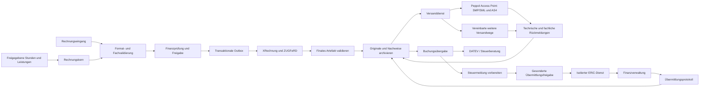

# E-Rechnung, Buchhaltung und Steuerübergabe für Palmscout

Übersicht der Rechnungsdomäne und möglicher Steuerschnittstellen. **Die erste begrenzte Rechnungsdomäne mit XRechnung-Ausgabe
und KoSIT-Prüfung ist inzwischen implementiert; externe Rechnungs-/Steuerübermittlung
steht noch aus.** Umsetzung und Grenzen:
[Architecture](ARCHITECTURE.md).
ACL wird hier als Access Control List bzw.
fachliche Zugriffsrechte verstanden; Netzwerkfreigaben sind ein zusätzlicher Aspekt.

## Befund im Repository

| Baustein | Tatsächlich vorhanden | Noch fehlend |
| --- | --- | --- |
| SaaS-Abrechnung | Stripe Checkout, Kundenportal und Webhooks in `backend/app/billing/` | Kein eigener EN-16931-Rechnungskern; Stripe-Abonnement ist keine Faktura für die Dienstleistungen eines palmscout-Kunden |
| Personalabrechnung | Lohnabrechnungsdatensätze und Veröffentlichungsrechte in `backend/app/payroll/` | Keine vollständige Entgeltberechnung und keine ELSTER-Lohnsteuermeldung |
| Mandanten | Firmenarbeitsbereiche, gesonderte Rechnungsaussteller, versionierte Finanzrechte und jährliche Nummernkreise | Rechte für künftige Transport-, Buchhaltungs-, Steuer- und Archivdienste |
| Dokumente | DMS und konfigurierbarer Objektspeicher | Kein nachgewiesenes unveränderbares Rechnungsarchiv mit Aufbewahrungsregeln und vollständiger Verfahrensdokumentation |
| Automatisierung | Versionierte Prozesse und kontrollierte Vorarbeiten | Rechnungs-/Buchungsaktionen, dauerhafte Outbox und belastbare externe Zustellzustände |
| Rechnungskern | Entwurf, Bearbeitung, Finanzprüfung, Nummerierung, Leistungsreferenzen und vollständiger Stornobeleg | Automatische Übernahme bestätigter Einsatzstunden, Sondersteuerfälle, Teilkorrekturen und vollständige Buchhaltung |
| Standards/Transport | UBL-XRechnung 3.0, KoSIT 1.6.3 mit Regelpaket vom 31.08.2026, XML-/Prüfbericht-Download | ZUGFeRD/Factur-X, Rechnungseingang, Peppol-Transport, AS4, SMP/SML |
| Steuerübergabe | Keine Implementierung gefunden | DATEV-Datenservice/Export, ERiC-Anbindung und mandantenbezogene Übermittlungsberechtigung |

Es wurde weder eine fiktive ELSTER-API noch ein scheinbar erfolgreicher
Peppol-Versand angelegt.

## Fachliche Grenzen und technische Aufteilung

Zwei Rechnungsbeziehungen sind strikt zu trennen:

1. neurofunken stellt dem Kunden palmscout-Nutzung in Rechnung. Bestehende Stripe-
   Belege bleiben ihrem ursprünglichen Rechnungsaussteller und Nummernkreis
   zugeordnet; sie werden nicht als neue zweite Rechnung dupliziert.
2. Eine HR-/Zeitarbeitsfirma stellt ihren Auftraggebern eigene Leistungen in Rechnung:
   freigegebene Einsatzstunden, vereinbarte Zuschläge, Vermittlungsprovisionen,
   Fahrtleistungen und vertraglich zulässige Nebenkosten.

Ein Mandant kann mehrere rechtliche Rechnungsaussteller besitzen. Deshalb
`tenant_id` und `legal_entity_id` getrennt führen. Ein Team oder Firmenlogo ist
keine steuerrechtliche Identität.

Der Rechnungskern kann zunächst als klar abgegrenzte Domäne im vorhandenen
FastAPI-System leben. Rechen-/Validierungsprozesse, Transport und ERiC laufen als
separate Worker bzw. Dienste mit eigenen technischen Berechtigungen. Die fachlichen
Grenzen werden von Anfang an definiert; unabhängige Microservices mit eigenen
Datenbanken sind eine spätere Betriebsentscheidung nach Last, Isolation und
Wartungsbedarf. Keine verteilten Schreibzugriffe in fremde Domänentabellen.

## Rechnungskern und deterministische Berechnung

Die erste Umsetzung verwendet Tabellen mit dem Präfix `finance_`, darunter
`finance_legal_entities`, `finance_grants`, `finance_invoice_sequences`,
`finance_invoices`, `finance_billed_services` und `finance_events`.
Weiteres Zielmodell: `billing_accounts`,
`invoices`, `invoice_lines`, `invoice_revisions`, `invoice_artifacts`,
`validation_reports`, `delivery_attempts`, `invoice_events`, `outbox_events`.

- Lieferant, Kunde, Leistungszeitraum, Referenzen, Zahlungsbedingungen, Währung,
  Steuerkennzeichen und relevante Identifikatoren als typisierte Daten.
- Geld und Mengen mit `Decimal`, dokumentierter Rundung, Auf-/Abschlägen,
  steuerlicher Behandlung und überprüfbaren Summen. KI berechnet weder Steuer
  noch verbindliche Rechnungsbeträge.
- Bei Finalisierung unveränderlicher Snapshot. Rechnungskorrekturen, Storno und
  Gutschrift werden fachlich unterschieden und referenzieren den ursprünglichen
  Beleg; ein gebuchter Beleg wird nicht überschrieben.
- Nummernkreis pro Aussteller mit transaktionaler Vergabe und Einmaligkeit.
  Quellleistungen dürfen nicht versehentlich mehrfach abgerechnet werden.
- Dokument-, Zustell-, Buchungs- und Zahlungsstatus bleiben getrennt.
  „AS4 zugestellt“ bedeutet weder „fachlich akzeptiert“ noch „bezahlt“.

## Formate und Versionsverwaltung

Ein neutrales Rechnungsmodell orientiert sich an EN 16931. Daraus werden die
benötigten Syntaxen/Profile erzeugt und anschließend vollständig geprüft.

- XRechnung: UBL/CII nach unterstütztem, fest versioniertem Profil; Schema,
  Schematron, Codelisten und Empfängeranforderungen zusammen prüfen.
- ZUGFeRD/Factur-X: strukturierte CII-Daten in einem konformen PDF/A-3-Dokument;
  XML und Sichtdarstellung aus demselben unveränderlichen Rechnungsstand erzeugen.
  Die Integrität beider Darstellungen gehört in die Abnahme.
- Peppol BIS Billing ist eine zusätzliche Austausch-/Profilanforderung. Eine
  beliebige XRechnung-Datei gilt nicht allein durch ihren Namen als passend für
  jeden Peppol-Empfänger.
- Zu jedem Beleg speichern: Format, Profil, Version, Regelpaket, Prüfergebnis,
  Prüfer-Version, Artefakthash und Erstellungszeit. Historische Rechnungen werden
  nicht stillschweigend gegen neue Regeln umgeschrieben.

Beim erneuten Abruf wurde das neuere XRechnung-Bundle **3.0.2, Summer 2026 Bugfix
vom 31.08.2026** verifiziert. Es ersetzt die zuvor in diesem Entwurf genannte
Winter-Fassung. Die Umsetzung verwendet das KoSIT-Regelpaket vom 31.08.2026 und
Validator 1.6.3 mit festgehaltenen SHA-256-Werten im Dockerfile des Prüfdienstes.
FeRD bietet **ZUGFeRD 2.5.2 vom 04.08.2026** an; die ZUGFeRD-Erzeugung ist weiterhin
ein eigener Ausbauschritt. [KoSIT-Versionen](https://xeinkauf.de/xrechnung/versionen-und-bundles/),
[FeRD-Downloads](https://www.ferd-net.de/download-zugferd)

Das BMF unterscheidet strukturierte E-Rechnungen von einfachen PDF-Rechnungen.
XRechnung und geeignete ZUGFeRD-Profile sind mögliche Formate; die Profile MINIMUM
und BASIC-WL erfüllen die dort erläuterten Anforderungen nicht. Empfang,
Ausstellung, Übergangsregeln und B2G-Vorgaben sind getrennt zu betrachten.
[BMF-FAQ, Stand März 2026](https://www.bundesfinanzministerium.de/Content/DE/FAQ/e-rechnung.html)

## Versand und Empfang: AS4, SMP, SML

**Erste Ausbaustufe: Access-Point-Anbieter anbinden.** Palmscout betreibt dabei
keinen eigenen Peppol Access Point und kein eigenes SMP. Der Adapter übernimmt
Teilnehmeridentität, unterstützte Dokument-/Prozesstypen, Auftrags-ID, Zustellstatus
und signierte bzw. authentisierte Rückmeldungen des Anbieters.

SMP veröffentlicht Teilnehmer-/Dienstmetadaten; SML unterstützt deren Auffinden;
AS4 ist ein Transportprofil zwischen Access Points. Rollen, Zertifikate und
Netzwerkvorgaben gehören zum Betrieb, nicht allein zur XML-Erzeugung.
[OpenPeppol eDelivery-Spezifikationen](https://docs.peppol.eu/edelivery/)

- Eingangsbelege: authentisierte Webhooks, Signaturprüfung, Deduplizierung,
  Größenlimits, sichere XML-Verarbeitung ohne externe Entitäten, Quarantäne bei
  unklaren Dateien. Originalbytes vor Umwandlung sichern.
- Ausgang: nach Finalisierung über Outbox; wiederholbare Worker-Aufträge,
  Idempotenzschlüssel, Retry mit Begrenzung und sichtbare Fehlerwarteschlange.
- Bei unbekanntem Versandresultat zuerst Status beim Anbieter abgleichen. Ein
  Timeout darf nicht blind eine zweite Rechnung/Steuermeldung erzeugen.
- Empfängerdaten und Kanal sind versioniert; Versandfreigabe bindet an exakten
  Beleg, Empfänger und Kanal. Eine spätere Änderung hebt die Freigabe auf.

## Archivierung und ACL

Unveränderbare Speicherung ist als technische Eigenschaft nachzuweisen, etwa mit
geeignet konfiguriertem Object Lock/WORM, Versionierung, Prüfsummen, kontrollierten
Schlüsseln, Zugriffsprotokoll und getesteter Wiederherstellung. Ein Hash oder ein
PDF im bestehenden DMS allein begründet keine revisionssichere Archivierung.

Zu archivieren sind Originalrechnung, strukturierter Teil, zugehörige notwendige
Anhänge, Prüfnachweise, Freigaben und Übermittlungsprotokolle. Aufbewahrung nach
Belegtyp, Aussteller, Land, Fristbeginn und möglicher Aufbewahrungssperre steuern;
keinen pauschalen zehnjährigen Lösch-Timer erfinden. Gesetzliche Aufbewahrung und
Datenschutz-Löschung werden über nachvollziehbare Regeln aufgelöst.
[BMF zur Aufbewahrung](https://www.bundesfinanzministerium.de/Content/DE/FAQ/e-rechnung.html)

- Finanzrollen: Leserecht, Vorbereitung, Freigabe, Versand, Buchungsübergabe,
  Steuerübermittlung und Archivverwaltung gesondert vergeben.
- `tenant_id` wird aus der Authentisierung abgeleitet; Zugriff auf
  `legal_entity_id` zusätzlich prüfen. Gleiches gilt für Worker-Nachrichten,
  Objektschlüssel, Suchindizes, Webhooks und Exporte.
- Steuerberaterzugang zeitlich und inhaltlich begrenzen; widerrufbare Vollmacht
  und separate Mandanten-/Beraterzuordnung. Eine HR-Firmenkooperation erteilt
  keinen Zugriff auf Rechnungen oder Steuerakten.
- Unternehmenssperrung/-kündigung ist kein `CASCADE DELETE` auf steuerlich
  aufzubewahrende Rechnungen. Migration und Export des Archivs sind eigene Vorgänge.
- Bankverbindungen, Zertifikate und Versandmandate werden außerhalb von KI-Prompts
  verwaltet. KI-Agenten erhalten keine pauschalen Zahlungs-/Steuerrechte.

## Steuerberater, DATEV und ELSTER

**Standardweg:** strukturierte Belege und Buchungsdaten an die vorhandene
Buchhaltung/Steuerberatung übergeben. DATEV beschreibt Rechnungsdatenservices für
Belege und strukturierte Daten; vollständige Buchungssätze benötigen einen dafür
geeigneten Buchungsdatenweg. Die Anbindung der E-Rechnungsplattform allein ersetzt
keine komplette Buchhaltung.
[DATEV Rechnungsdatenservice](https://www.datev.de/web/de/berufsgruppenuebergreifend/mydatev/datenservices/rechnungsdatenservice-1_0-einrichten),
[DATEV Hersteller-FAQ](https://www.datev.de/web/de/berufsgruppenuebergreifend/ueber-datev/portfolio/oekosystem/partnering/datev-marktplatz/faq-zur-datev-e-rechnungsplattform-fuer-softwarehersteller)

Erster Lieferumfang: nachvollziehbares Exportpaket mit Belegverweisen und
Prüfsummen, konfiguriertem Kontenrahmen, Mandanten-/Beraternummer,
Wirtschaftsjahr, Buchungsperiode und erforderlichen Steuerkennzeichen. Ein
beliebiges CSV wird nicht als „DATEV-konform“ bezeichnet. Formatbeschreibung,
Importsystem und Referenzfälle müssen geprüft werden. Eine API-Verbindung folgt
mit passendem Produkt-/Partnerzugang, Mandantenautorisierung und getesteten
Rückmeldungen.

**Direktübermittlung:** eigener ERiC-Adapter für genau unterstützte Verfahren und
Steuerjahre. Geplante Reihenfolge: Umsatzsteuer-Voranmeldung aus vollständigen
geprüften Buchungsdaten; danach Lohnsteuer-Anmeldung/Lohnsteuerbescheinigung nur
auf Basis eines geeigneten Entgelt-/Payroll-Systems. Die HR-App kennt ohne
zusätzliche Daten nicht alle steuerlich relevanten Geschäftsvorfälle. Ihre
Ausgangsrechnungen allein ergeben keine vollständige Steuererklärung.

**Jahreserklärungen:** Umsatzsteuer-Jahreserklärung sowie – je nach Rechtsform und
steuerlicher Einordnung – Körperschaftsteuer, Gewerbesteuer, Feststellung und
Anlage EÜR als getrennte Verfahren planen. Die amtliche Formularübersicht führt
diese Verfahren getrennt. Welche davon ein Mandant benötigt, wird mit seiner
Steuerberatung festgelegt; Palmscout leitet dies nicht aus dem Firmenlogo oder
einem HR-Rollennamen ab.
[ELSTER-Formularübersicht](https://www.elster.de/eportal/formulare-leistungen/alleformulare)

Jedes Verfahren benötigt ein eigenes, geprüftes Mapping aus dem Buchhaltungs-
system, ergänzende Angaben, unterstützte Steuerjahre und Referenzfälle. Ein
Verfahrenskatalog zeigt deshalb ausdrücklich an, ob nur Kanzleiübergabe,
Vorbereitung, Plausibilisierung oder bereits Test-/Produktivübermittlung möglich
ist. Fehlende Eingaben und nicht unterstützte Jahre sperren die Übermittlung.
Die Jahreserklärungen folgen nach den ersten periodischen Meldungen; eine
Umsatzsteuer-Voranmeldung wird nicht als vollständige Jahreserklärung bezeichnet.

ELSTER stellt ERiC als native C-Bibliothek zur Plausibilisierung und verschlüsselten
Übermittlung bereit. Herstellerregistrierung, Zugang zum Entwicklerbereich und
Hersteller-ID sind dabei konkrete Voraussetzungen. Es wird keine öffentliche
allgemeine REST-API vorausgesetzt.
[ELSTER für Entwickler](https://www.elster.de/elsterweb/infoseite/entwickler)

Geplante Entitäten: `tax_mandates`, `accounting_exports`, `tax_return_drafts`,
`tax_return_revisions`, `tax_approvals`, `tax_submissions`, `tax_receipts`.

- Land, Steuerart, Jahr/Zeitraum, Aussteller, Steuernummer und Datenstand in jeder
  Meldung explizit. Korrektur-/Berichtigungskennzeichen fachlich korrekt führen.
- Vorbereitung und Plausibilisierung ohne Versand; zuständige Person sieht
  Formularwerte, Herkunft und Änderungen gegenüber der letzten Fassung.
- Übermittlungsfreigabe bindet an Datenhash, Verfahren, Zeitraum und Sender.
  Vollmacht/Zertifikat und aktuelle Berechtigung werden direkt vor Versand geprüft.
- Zertifikate und PINs verschlüsselt bzw. im Secret-System, nie in Logs, Browser-
  speicher, KI-Kontext oder archivierten Rohkonfigurationen.
- Ergebnis anhand amtlicher Rückmeldung bewerten und das Übermittlungsprotokoll
  speichern. Technischer Erfolg ist keine steuerliche inhaltliche Anerkennung.
- Persönliche Einkommensteuererklärungen von Beschäftigten/Bewerbern sind ein
  eigenes Produkt-/Einwilligungsgebiet und werden nicht aus einem HR-Zugang abgeleitet.
- Für weitere EU-Staaten länderspezifische Adapter und Meldeverfahren vorsehen.
  ELSTER deckt Deutschland ab; Peppol ersetzt kein Steuererklärungsverfahren.

## Automatisierungspolitik

KI darf Belege zuordnen, unklare Angaben markieren, Kontierung vorschlagen und
Rückfragen vorbereiten. Berechnung, Schemaprüfung, Steuercodes, Freigaberechte und
Versand werden deterministisch geprüft. Automatisches Ausstellen/Übermitteln
bedarf je Mandant einer ausdrücklich konfigurierten, fachlich zulässigen Regel
mit Grenzen, Verantwortlichen und Abbruchmöglichkeit. Ein KI-Vorschlag ist keine
Finanzfreigabe. Bestehende allgemeine HR-Prozessrechte berechtigen nicht zum
Versenden von Rechnungen oder Steuererklärungen.

## Lieferfolge und Abnahmekriterien

| Stufe | Lieferumfang | Abnahme |
| --- | --- | --- |
| F1 | Eigener Rechnungskern, Leistungsbezug, Nummernkreis, Finanzrechte, Korrekturen | Rundungs-/Steuerreferenzfälle, keine doppelte Leistung/Nummer, Mandanten-Isolation, unveränderliche Freigabestände |
| F2 | E-Rechnungseingang und XRechnung-Ausgabe mit Validator | Positive und negative amtliche Referenzfälle; gefährliche XML/Anhänge abgewiesen; Originale erhalten |
| F3 | ZUGFeRD und Archiv | PDF/A-/XML-Profilprüfung, konsistente Darstellung, unveränderbare Speicherung, Wiederherstellung und dokumentierte Fristen |
| F4 | Peppol-Anbieter und Rückmeldungen | Testteilnehmer, empfängerabhängige Profile, Deduplizierung, Timeout-/Retry-Tests, belastbare Quittungen |
| F5 | Steuerberaterexport und DATEV | Erfolgreicher Import mit einer Pilotkanzlei; Mandanten-/Periodenzuordnung und Belegverknüpfung bestätigt |
| F6 | Ausgewählte direkte ELSTER-Meldungen | Hersteller-/Testzugang, ERiC-Validierung, fachliche Referenzfälle, getrennte Freigabe, nachvollziehbare Testübermittlung |
| F7 | Ausgewählte betriebliche Jahreserklärungen | Vollständige Buchhaltungs- und Ergänzungsdaten, Verfahren/Jahr fachlich geprüft, Abstimmung mit Pilotkanzlei, Korrektur- und Übermittlungsnachweise |

Für diese Stufen fehlen noch die bestätigten Betreiberangaben, ein gewählter
Peppol-/Archiv-/DATEV-Zugang und gegebenenfalls der ELSTER-Herstellerzugang. Die
Domänenmodellierung und lokale Prüfungen können vorher erfolgen; eine reale
Registrierung, kostenpflichtige Beauftragung oder produktive Übermittlung wurde
mit diesem Architekturentwurf nicht ausgeführt.
